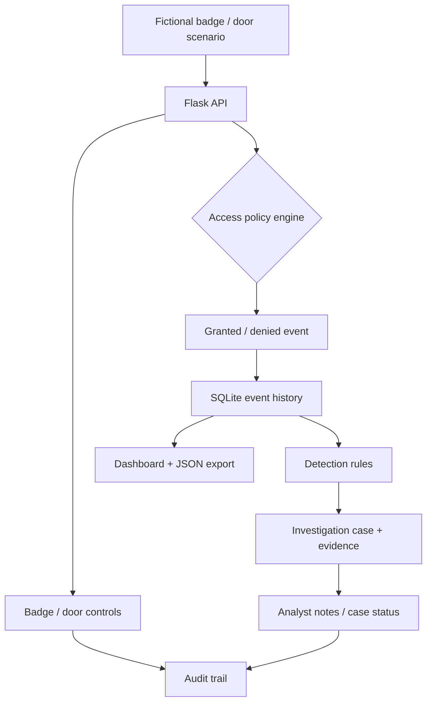

# 🛡️ Sentinel Access Lab

**RFID access-control simulation | Python | Flask | SQLite | Security operations**

Sentinel Access Lab is a local, fictional physical-access security lab for practicing access policy decisions, event monitoring, incident investigations, and administrative response. It **does not read real RFID cards or connect to actual doors or workplace systems**.

## Features

- Simulate badge presentations at four doors with role-based access rules.
- Allow or deny access based on badge status, door policy, simulated lockdown, and after-hours conditions.
- Run routine, repeated-denial, revoked-badge, and forced-door scenarios.
- Generate investigation cases with linked event evidence.
- Add analyst notes and move cases through `open`, `investigating`, and `resolved`.
- Activate, suspend, or revoke simulated badges; toggle simulated door lockdown.
- View an audit trail and export a JSON evidence package.
- Store fictional data locally in SQLite and protect the dashboard with a password.

## Architecture



## Simulated environment

| Area | Example policy |
|---|---|
| Main entrance | Employee, security, visitor |
| Office floor | Employee, security |
| Server room | Security only |
| Loading entrance | Employee, security |

The seed dataset includes four fictional badge identities: employee, security, visitor, and a revoked employee badge. In the after-hours simulation, only the security role can be granted access. A simulated lockdown denies all badge presentations at that door.

## Detection and investigation

| Rule | Trigger | Severity |
|---|---|---|
| `DENIED_BURST` | At least five denied presentations by one badge at one door within 60 seconds | Medium |
| `REVOKED_BADGE` | A revoked simulated badge is presented | High |
| `FORCED_DOOR` | A synthetic forced-door sensor scenario is run | High |

Cases contain the linked events used as evidence. An analyst can review the evidence, record notes, and update case status. Repeated findings are grouped into an open or investigating case when applicable.

## Run locally

Requires Python and Flask 3.1 or later.

```bash
python -m pip install -r requirements.txt
python sentinel_access_lab.py
```

Open **http://127.0.0.1:5002** and use the password shown on the first startup. The password is not printed again unless reset.

```bash
python sentinel_access_lab.py --reset-password
python sentinel_access_lab.py --self-test
```

The default database and local login configuration live in `~/.sentinel-access-lab/`, **outside the GitHub project folder**.

## Security and scope

This is a **local-only educational simulator**, not a production access-control system. It uses a single lab administrator password, hashed credentials, session cookies, CSRF checks, login throttling, and localhost binding. It has no RFID radio interface, card cloning, physical door controller, or workplace integration. Do not expose the local application directly to the internet or import real employee access records.

## Project design

Read [DESIGN_NOTES.md](DESIGN_NOTES.md) for the reasoning behind the data model, policy engine, detection logic, and security boundaries.

## Next steps

- [ ] Add sanitized screenshots of the dashboard and investigation screen.
- [ ] Expand test scenarios and automated coverage.
- [ ] Build a documented, authenticated export into Sentinel 2.0.
- [ ] Add optional role-based analyst accounts in a future version.

**Author:** [@cabralisjota](https://github.com/cabralisjota)  
**Purpose:** Defensive security learning and authorized testing.
